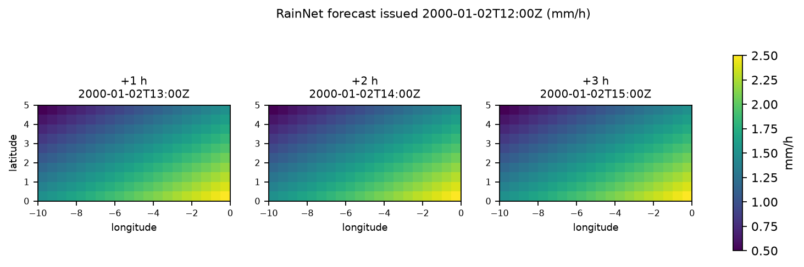

# Quickstart

In about five minutes you will generate a model project, watch it pass its
conformance suite, and publish a real forecast to disk.

Nothing here is a mock-up. Every block below is output captured from actually
running these commands; only absolute paths have been shortened.

## 1. Generate a project

```bash
uv run nowcast-new-model --name "RainNet" --product rain_obs --units "mm/h"
```

```text
Created models/rainnet with 14 files.

Next:
  uv sync --project models/rainnet
  uv run --directory models/rainnet pytest

The suite should pass now. Then replace every REPLACE THIS marker,
running it again after each change. README.md lists them in order.
```

Here is everything it wrote:

```text
.gitignore
Dockerfile
README.md
artifacts/v1/manifest.json
artifacts/v1/placeholder.npy
compose.yaml
config/default.json
pyproject.toml
src/rainnet_nowcast/__init__.py
src/rainnet_nowcast/__main__.py
src/rainnet_nowcast/entrypoint.py
src/rainnet_nowcast/model.py
tests/test_conformance.py
tools/make_sample_inputs.py
```

That is a complete, runnable project: a plugin, a composition root, a
configuration, a placeholder artifact bundle with a real SHA-256 manifest, a
container build, and a conformance test wired to the shared suite.

## 2. Install it

```bash
uv sync --project models/rainnet
```

This takes seconds rather than minutes, because the runtime pulls in no deep
learning framework. Your model will add its own later.

## 3. Watch it pass conformance

```bash
uv run --directory models/rainnet pytest
```

```text
...................                                                      [100%]
19 passed in 6.47s
```

```{admonition} This is the point of the scaffold
:class: tip

Nineteen contract checks pass **before you have written a line**. The generated
project ships a persistence predictor, so there is a working baseline from the
first minute. When you replace it and something breaks, the failure means *the
thing you just changed* — which is the only diagnostic that works for someone
who has not read this codebase.
```

## 4. Make some observations

The project can write sample inputs through its own decoder, so they cannot
drift from the format it actually reads:

```bash
uv run --directory models/rainnet python tools/make_sample_inputs.py \
    --into data/raw --run-time 2000-01-02T12:00:00Z
```

```text
Wrote 3 observations to data\raw
  rain_obs.200001021000.bin
  rain_obs.200001021100.bin
  rain_obs.200001021200.bin
```

## 5. Publish a forecast

```bash
uv run --directory models/rainnet rainnet-nowcast \
    --config config/default.json --source local \
    --input-dir data/raw --output-dir outputs
```

```text
2026-11-05 13:41:40,519 INFO Model ready on auto; 3 input steps
2026-11-05 13:41:40,527 INFO Acquired 3 consecutive inputs ending at 2000-01-02T12:00:00+00:00
2026-11-05 13:41:40,626 INFO Generated lead +1: 2000-01-02T13:00:00+00:00
2026-11-05 13:41:40,644 INFO Generated lead +2: 2000-01-02T14:00:00+00:00
2026-11-05 13:41:40,660 INFO Generated lead +3: 2000-01-02T15:00:00+00:00
2026-11-05 13:41:40,664 INFO Published complete run: outputs\rainnet\rain_obs\2000\01\02\1200Z
```

```text
outputs/rainnet/rain_obs/2000/01/02/1200Z/
├── manifest.json
├── rainnet_20000102T1200Z_f001_20000102T1300Z.tif
├── rainnet_20000102T1200Z_f002_20000102T1400Z.tif
└── rainnet_20000102T1200Z_f003_20000102T1500Z.tif
```

One directory per issue time. The name of each file carries the model, the
issue time, the lead index and the valid time, so a file is identifiable
without opening it.

## 6. Look at what came out



```{note}
The three panels are identical, and that is correct. The generated placeholder
is a **persistence** model: it repeats the most recent observation at every
lead. The figure shows that the plumbing works end to end — acquisition,
decoding, inference, georeferencing, publication — not that anything has been
forecast. Replacing persistence with your network is [the next
tutorial](../tutorials/01-your-first-model.md).
```

The files are ordinary georeferenced GeoTIFFs:

```text
driver      GTiff
crs         EPSG:4326
size        20 x 10
bands       1 ('float32',)
band name   ('rain_obs',)
units       ('mm/h',)
nodata      -9999.0
transform   (0.5, 0.0, -10.0, 0.0, -0.5, 5.0)

model            RainNet
model_version    v1
run_time         2000-01-02T12:00:00+00:00
valid_time       2000-01-02T13:00:00+00:00
lead_hours       1
input_product    rain_obs
units            mm/h
AREA_OR_POINT    Area
```

## 7. Read the provenance record

Every run writes a `manifest.json` beside its outputs:

```json
{
  "schema_version": 1,
  "status": "complete",
  "created_at": "2026-11-05T16:41:40.560578+00:00",
  "model": "RainNet",
  "model_version": "0.1.0",
  "bundle_version": "v1",
  "artifacts": {
    "checkpoint": {
      "name": "placeholder.npy",
      "sha256": "579f4fc9e240b80aade6941d3fba86534d9e959a8520066318b52ed266243e65"
    }
  },
  "normalization": { "kind": "identity" },
  "preprocess": [
    { "kind": "missing-policy", "policy": "zero_rain", "max_fraction": 0.05, "fill": 0.0 }
  ],
  "postprocess": [],
  "source": "local:data/raw",
  "units": "mm/h",
  "crs": "EPSG:4326"
}
```

It records which artifacts were used and their checksums, which processing
stages ran and in what order, where the data came from, and the versions of
everything involved. That is what makes a published forecast auditable months
later. [Artifacts and manifests](../concepts/artifacts-and-manifests.md)
covers every field.

## What just happened

```{image} ../_static/pipeline-spine.svg
:alt: The pipeline spine, from source through decoder, optional stages and the transform into the predictor, and back out to the sink
:width: 100%
```

You composed a deployment and the runtime drove it through that sequence. You
supplied the model; everything else came from the shared runtime and its
built-in adapters.

## Next

- [Your first model](../tutorials/01-your-first-model.md) replaces the
  placeholder with a real network.
- [How it works](../concepts/architecture.md) explains the spine above and why
  the seams fall where they do.
