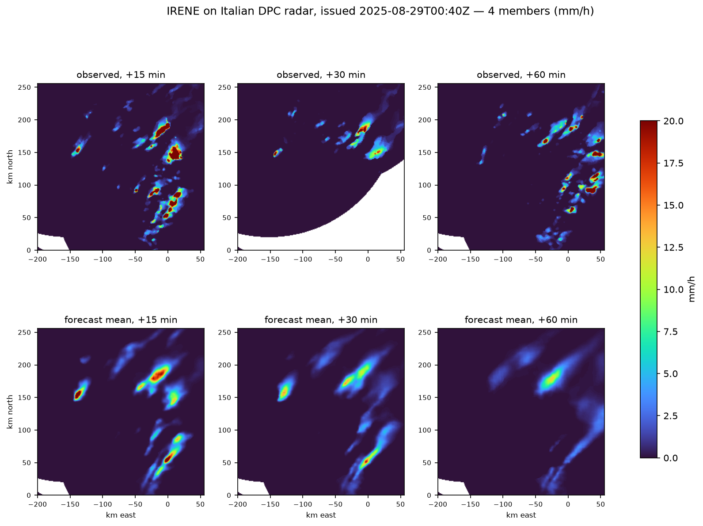

# Porting a published model: IRENE

This is the platform's own acceptance test, written up as a walkthrough.

[IRENE](https://huggingface.co/it4lia/irene) is a ConvGRU ensemble nowcaster
from Fondazione Bruno Kessler, trained on the Italian DPC radar mosaic and
published on HuggingFace under BSD 2-Clause. It was chosen because it is
unlike the model this runtime grew around on every axis that matters:

| | InceptionV4 | IRENE |
| --- | --- | --- |
| Time step | 1 hour | **5 minutes** |
| Window | 12 observations | 6 observations |
| Horizon | 6 leads | **12 leads** |
| Output | deterministic | **ensemble, 10 members** |
| Architecture | direct encoder-decoder | **recurrent ConvGRU** |
| Source | GSMaP binary over FTP | radar NetCDF4 |
| Grid | 0.1° geographic | **1 km projected, in metres** |
| Transform | log1p and z-score | Marshall-Palmer dBZ |
| Bundle | checkpoint, mean, std | checkpoint only |

```{admonition} The result, stated plainly
:class: important

IRENE runs, passes all nineteen conformance checks, and publishes 48
georeferenced ensemble forecasts. Getting there required **one change to the
runtime** and **two to the conformance suite**. All three are described below,
because a platform that only reports its successes is not worth trusting.
```



Four members, visibly different, and the cell decaying over the hour. The white
strip along the top is the radar coverage mask carried through from the inputs.

## 1. Read the model before writing anything

The facts that shaped every later decision, from the model card and the source:

- `predict(past, forecast_steps, ensemble_size)` takes `(T, H, W)` float32 in
  mm/h and returns `(E, T, H, W)` in mm/h.
- **The normalization lives inside `predict`**: a Marshall-Palmer dBZ transform,
  `Z = 200 R^1.6`, clipped to 0-60 dBZ and mapped to [-1, 1]. No mean, no std.
- The published checkpoint is a **770 MB PyTorch Lightning artefact** needing
  `weights_only=False`, because its hyperparameters pickle optimizer classes.
- A plain `nn.Module`, `EncoderDecoder`, sits underneath and needs only torch.
- Fully convolutional, but both dimensions must be a multiple of 32.

## 2. Scaffold, then replace

**From the workspace root:**

```bash
uv run nowcast-new-model --name "IRENE" --slug irene \
    --product dpc_sri --units "mm/h" --into models/irene
```

Everything that follows is inside `models/irene/`. The files this port
touched, beyond what the scaffold wrote:

```text
models/irene/
├── config/default.json              edited: domain, policy, members, seed
├── artifacts/v1/                    replaced: real bundle and manifest
├── src/irene_nowcast/
│   ├── entrypoint.py                rewritten: composition root
│   ├── model.py                     rewritten: predictor and transform
│   ├── decoder.py                   new: the DPC NetCDF format
│   ├── stages.py                    new: the Threshold postprocess
│   └── _vendor/                     new: upstream architecture, verbatim
│       ├── LICENSE
│       ├── model.py
│       └── utils.py
├── tests/test_conformance.py        edited: realistic radar fields
└── tools/prepare_artifacts.py       new: shrink the checkpoint
```

## 3. Shrink the checkpoint before it reaches production

Two thirds of the published file is optimizer state, schedulers and loop state.
Keeping it means every deployment downloads and checksums 770 MB to run a
257 MB model, and loads it with `weights_only=False` on every container start.

`models/irene/tools/prepare_artifacts.py` does that conversion **once,
offline**. From `models/irene/`:

```bash
uv run python tools/prepare_artifacts.py \
    --checkpoint /path/to/model.ckpt --bundle artifacts/v1
```

```text
Extracted 40 tensors
     770,192,441 bytes  model.ckpt
     256,722,959 bytes  irene.pt  (33.3%)
```

The resulting bundle holds tensors only, so the operational loader reads it
with `weights_only=True`. The manifest records the digest of the source
checkpoint, so the provenance chain back to the Hub is unbroken.

```{tip}
Do this for any Lightning checkpoint. The unpickling that a training artefact
requires is a code-execution path, and confining it to one offline step with a
recorded digest is much better than repeating it in production.
```

## 4. Vendor only what you need

The published package requires Python 3.13 and declares twenty-odd
dependencies including JupyterLab, TensorBoard and pysteps. Inference needs
none of that.

`models/irene/src/irene_nowcast/_vendor/` holds `model.py` and `utils.py`
copied verbatim, with the upstream BSD 2-Clause licence beside them. Both
import only torch and numpy.

```{important}
Vendored code is kept **byte-identical** to upstream so it can still be diffed
against it, which means excluding it from the linter rather than reformatting
it. The workspace does that with `extend-exclude = ["**/_vendor/**"]`.
```

## 5. Declare the transform rather than hiding it

The published `predict` normalizes internally. Declaring it as the plugin's
`Transform` instead means the runtime applies it, and **it appears in every run
manifest**:

```{code-block} json
:caption: from a run manifest, models/irene/outputs/.../manifest.json

"normalization": {
  "kind": "marshall-palmer-dbz",
  "relation": "Z = 200 * R**1.6",
  "decibel_range": [0, 60],
  "representable_mm_h": [0.0364633, 205.048],
  "clamped_before_inverse": true
}
```

Two properties of that scale matter operationally, and neither is obvious:

**It saturates at the bottom.** Model space `-1` inverts to 0.0365 mm/h, not
zero. Without intervention every dry pixel in the domain carries a uniform
drizzle that no forecast intended.

**The published inference path omits the clamp used in training.** A member
drifting past `+1` grows exponentially through the inverse: `1.2` becomes
486 mm/h, `1.5` becomes 1776.

Both are handled by a `Threshold` postprocess step, which is exactly what the
postprocess port is for.

```{warning}
Derive bounds like these **from the transform**, not from a literal.

Writing `OUTPUT_FLOOR = 0.036463` looked right and was wrong by less than a
float32 ulp, so `values <= floor` matched nothing and the first real run came
out with a uniform 0.0365 mm/h over the whole domain and zero exact zeros. It
looked like a forecast. Computing the floor as
`normalized_to_rainrate(-1.0)` makes the comparison exact by construction.
```

## 6. Write a decoder for the real format

The DPC mosaic is NetCDF4, which is HDF5 underneath, so `h5py` reads it without
the netCDF C library. The decoder is about ninety lines and implements
`native_grid`, `units`, `observed_at`, `read`, plus the optional `filename` and
`synthesize` that let conformance run on no real data.

Two things in the published sample are worth recording rather than silently
accommodating:

```{admonition} The units attribute is wrong
:class: warning

`RR` declares `units = kg m-2 s-1`. Its values — maximum 61.6, mean 0.61, 84%
zeros, no negatives — are a rain rate in **mm/h**. The same figure in
kg m⁻² s⁻¹ would be 220,000 mm/h. Every code path in the upstream package
treats it as mm/h. Applying the 3600× conversion the attribute implies would
produce numbers that are catastrophically wrong and perfectly plausible to a
pipeline that does not check.
```

```{admonition} The projection is not determinable
:class: warning

The variable carries `grid_mapping = "crs"` and the file contains no such
variable. The CRS is therefore an **assertion by configuration**, declared in
one place and recorded in every manifest so it can be contradicted:

In `models/irene/src/irene_nowcast/entrypoint.py`:

    ASSUMED_CRS = "EPSG:3003"
    NATIVE_GRID = Grid(ASSUMED_CRS, -600000.0, 650000.0, 1000.0, 1000.0, 1200, 1400)

Coordinates in the file are cell centres, so the grid origin is half a cell
beyond: x starts at -599500 and the origin is -600000.
```

## 7. Configure the deployment

```{code-block} json
:caption: models/irene/config/default.json

{
  "domain": { "west": -200000.0, "south": 0.0, "east": 56000.0, "north": 256000.0 },
  "product": "dpc_sri",
  "missing_policy": "zero_rain",
  "max_missing_fraction": 0.95,
  "ensemble_members": 4,
  "seed": 20260101
}
```

Three choices worth explaining:

**`max_missing_fraction: 0.95`.** Radar coverage fills about half of the
rectangle, so more than half of a real scan is NaN. The 0.05 that suits a
satellite product would reject every observation.

**`missing_policy: zero_rain`, not `normalized_zero`.** For this transform the
value that maps to model-space zero is about 2.7 mm/h — moderate rain, not an
absence of it. Filling gaps with it would invent precipitation over everywhere
the radar cannot see.

**`seed`.** Members come from fresh noise per decoder pass, so an unseeded run
is not reproducible. The seed is recorded in the manifest.

The domain is 256 × 256 cells, which satisfies the model's multiple-of-32
constraint without padding.

## 8. Run it

**From the workspace root:**

```bash
uv run --directory models/irene python tools/make_sample_inputs.py \
    --into data/raw --run-time 2025-08-28T22:00:00Z
uv run --directory models/irene irene-nowcast \
    --config config/default.json --source local \
    --input-dir data/raw --output-dir outputs --device cpu
```

```text
INFO Model ready on cpu; 6 input steps
INFO Acquired 6 consecutive inputs ending at 2025-08-28T22:00:00+00:00
INFO Generated lead +1: 2025-08-28T22:05:00+00:00
...
INFO Generated lead +12: 2025-08-28T23:00:00+00:00
INFO Published complete run: outputs/irene/dpc_sri/2025/08/28/2200Z
```

48 files, 12 leads × 4 members:

```text
irene_20250828T2200Z_f001_m000_20250828T2205Z.tif
irene_20250828T2200Z_f001_m001_20250828T2205Z.tif
...
```

And conformance:

```text
...................                                                      [100%]
19 passed in 62.09s
```

## What this cost the platform

### One runtime change

`Config.load` called `cls(**payload)`, so **any key the runtime did not own was
a TypeError**. IRENE needs two settings of its own, and the only alternatives
were a second configuration file per deployment or model settings on the
command line, which `pipeline.main` does not admit either.

`Config` now carries unknown keys in `extra`. Additive, defaulted, no plugin
changes: runtime 0.3.0 → 0.3.1.

### Two conformance suite changes

**The suite built a frame no decoder could produce.** `raw_frame` paired values
containing gaps with an all-empty mask, and a gap-filling stage then failed on
it. The mask is now derived from the values, as every decoder derives it.

**The suite assumed transforms are invertible.** A reflectivity scale is
deliberately lossy, so `inverse(forward(0))` is the floor rather than zero. A
transform can now declare `representable_minimum` and `representable_maximum`,
and the round-trip check narrows to the range it claims.

### Nothing else

The pipeline, the scheduler, the ports, the sink, the stages and the atomic
publication needed no change at all. The five-minute step, the non-uniform
window machinery, the ensemble member axis and the declared output width all
worked the first time they met a model that actually used them.

## What this does not show

```{warning}
**No skill is demonstrated here.** The inputs are a synthetic moving blob. The
forecast decaying to nothing over the hour is what that input deserves and says
nothing about the model's behaviour on real radar.

The CRS is asserted, not verified. The one-file-per-scan assumption is not
confirmed against the operational DPC feed. Whether IRENE is useful over Italy
is a question for its authors and its own validation record, and nothing in
this platform will answer it.
```

### A limitation the port did surface

The published sample is a **datacube**: 54 timesteps in one NetCDF. The
contracts assume **one observation per object** — `observed_at` maps one file
name to one time, and `fetch` returns a `Path` with nowhere to carry an index.

If the operational feed is one file per five-minute scan, as the port assumes,
this never matters. If it is a datacube, the contracts cannot express it today,
and that would be the first genuine port this platform is missing.
